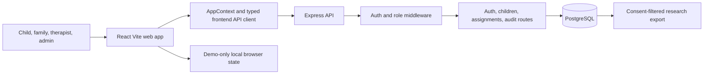

# Playground Life Technical Requirements Document

**Document status:** Current-state technical requirements and implementation guardrails  
**Architecture baseline:** React 18 + Vite + TypeScript client; Express 5 + PostgreSQL backend

## 1. Architecture overview



The browser application is composed around `src/App.tsx`, role dashboards, `AppContext`, activity data, play engines, and shared UI components. The production API starts at `server/index.ts` and currently mounts auth, children, assignments, and audit routes. Files for additional routes exist in the repository, but they are not production endpoints until explicitly mounted, tested, and documented.

## 2. Frontend requirements

### Application and state

- Use TypeScript and the existing Vite/React stack. Do not introduce a second state-management system unless the current provider contract is deliberately migrated.
- Keep routes at `/`, `/therapist`, `/family`, and `/admin`; route changes require redirected legacy paths and updated access tests.
- Keep local storage strictly in the demo/workflow-test path. Production API availability must be unambiguous in UI and code.
- Maintain error boundaries and user-understandable failure states for login, data loading, assignment saving, and game completion.

### Gameplay platform

- Preserve the `GameConfig` content contract in `src/data/games.ts`: stable ID, engine, category, difficulty, content version, age range, learning goal, adult prompt, supports, success criteria, estimated minutes, and config.
- `GamePlayer` must remain the orchestration boundary for preflight information, activity execution, sensory controls, AAC logging, breaks, exit, completion, and result persistence.
- Each engine must accept its configured difficulty/support values and must emit valid completion data without assuming a verbal, mouse-only, or touch-only interaction.
- Game result fields must remain bounded and typed: duration, 0–100 score, interaction count, optional trial/error/accuracy metrics, skill scores, and any validated engine metrics.

### Accessibility and sensory safety

- Meet keyboard accessibility for every actionable control, with visible focus and no pointer-only essential action.
- Preserve switch/dwell input support and its test coverage. Avoid timeouts that prevent deliberate input.
- Respect `prefers-reduced-motion` and the app reduced-motion setting across blobs, celebrations, transitions, and game engines.
- Respect sound and voice preferences before playback. Provide a controllable, non-auditory equivalent for any instruction or feedback.
- Support AAC, point, gesture, speech, and tap as valid response modalities where a response is requested.

## 3. Backend requirements

### Security and access control

- Use Argon2id password hashes, signed JWT session handling, secure HTTP-only cookies when used, Helmet, restrictive CORS, JSON-body limits, and rate limiting as the baseline.
- Authenticate before any protected route and enforce role plus clinic ownership on every data query and mutation.
- Never accept a clinic, child, assignment, or user identifier as authorization proof by itself; derive permitted clinic scope from the authenticated session.
- Record audit events for access-relevant and data-changing operations without leaking unnecessary sensitive content into logs.

### API contract

| Area | Required behavior |
|---|---|
| Auth | Login, logout, current-user lookup, and staff provisioning must validate input and establish role/clinic scope |
| Children | List/create operations must be clinic-filtered and restricted to authorized staff/family views |
| Assignments | Create, approval, and results operations must enforce relationship to child, assignment, and clinic |
| Audit | Read access must be role-limited and clinic-scoped |
| Research | Must be mounted only after export logging, parameterized queries, consent checks, retention rules, and route tests are complete |

### Database and migrations

- PostgreSQL is the source of truth for production: clinics, users, children, family links, goals, assignments, results, audit logs, moods/events/preferences, research consent, and export records.
- Use ordered, idempotent migration files and record every applied migration in `schema_migrations`.
- **Current implementation gap:** `server/migrate.ts` reads only `001_init.sql`, while the repository contains `002` through `005` SQL files. Before production use, replace this with an ordered migration runner that applies and records every pending file exactly once; test both clean install and upgrade paths.
- Use parameterized SQL for all identifiers/values. **Current implementation gap:** the research route interpolates child IDs into `IN (...)`; it must be changed to a parameterized array query before mounting.

## 4. Data, privacy, and research requirements

- Treat diagnosis, birth date, child notes, personalization profiles, game results, and audit data as sensitive clinic data.
- Store only data needed for the stated care workflow. Free text requires a defined purpose, access rule, retention rule, and export default of exclusion.
- Keep operational analytics separate from research exports. Research eligibility requires `research_consent = true`, consent version, timestamp, and responsible user.
- Include event schema version, content version, engine key, and export/data-dictionary version in research records.
- Derive research participant identifiers using a per-clinic secret held outside source code; the current deterministic string salt is not adequate production key management.

## 5. Quality gates

Before a release affecting these areas, run and record:

```text
npm test
npm run lint
npm run typecheck:server
npm run build
```

Add integration coverage for authentication, role restrictions, clinic boundaries, migration upgrades, assignment result writes, and consent-filtered export. Add component/interaction coverage for every engine and input/sensory setting affected by a change.

## 6. Deployment requirements

- Supply configuration through environment variables, beginning from `.env.example`; do not place credentials, signing secrets, or research salts in the repository.
- Deploy the web and API services separately using the supplied Docker/docker-compose assets only after build, migration, health-check, backup/restore, and rollback procedures are verified.
- Run backups and restore drills against a non-production target; review the retention/deletion policy before holding real records.
- Do not represent included review plans as completed external reviews. Production readiness requires the independent reviews and approvals named in `README.md` and the governance documents.

## 7. Technical acceptance criteria

- A fresh database applies all numbered migrations in order and an existing database upgrades without data loss.
- Every exposed API endpoint has authentication, authorization, input validation, clinic isolation, and error-path tests.
- No route accesses data from an unverified client-provided clinic scope.
- Every game engine passes smoke, completion, exit, reduced-motion, and supported-input tests.
- Research export uses parameterized queries, a protected per-clinic pseudonymization secret, consent filtering, audit/export records, and an approved retention policy.
