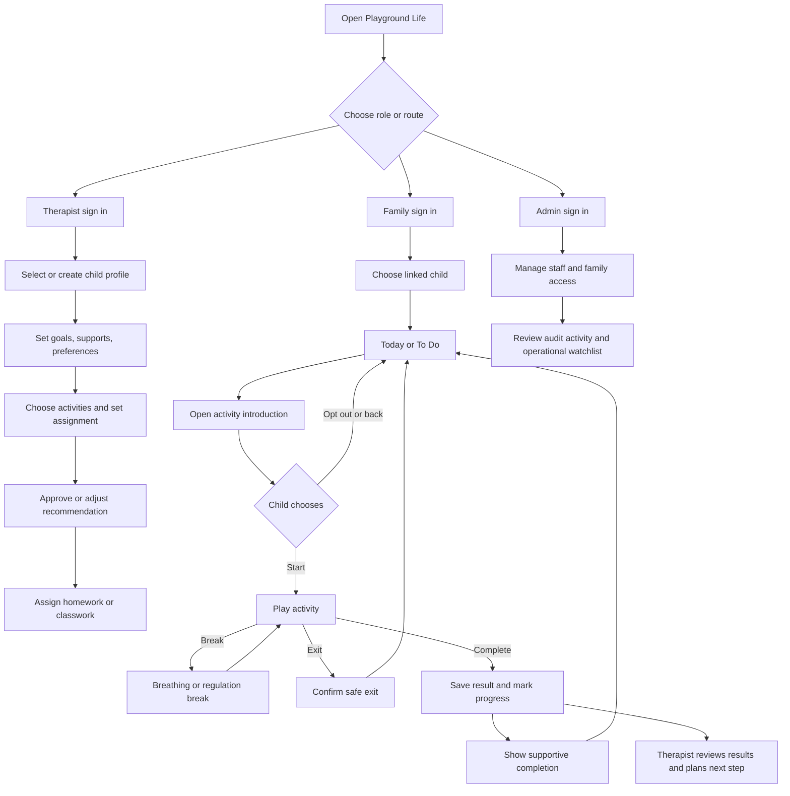
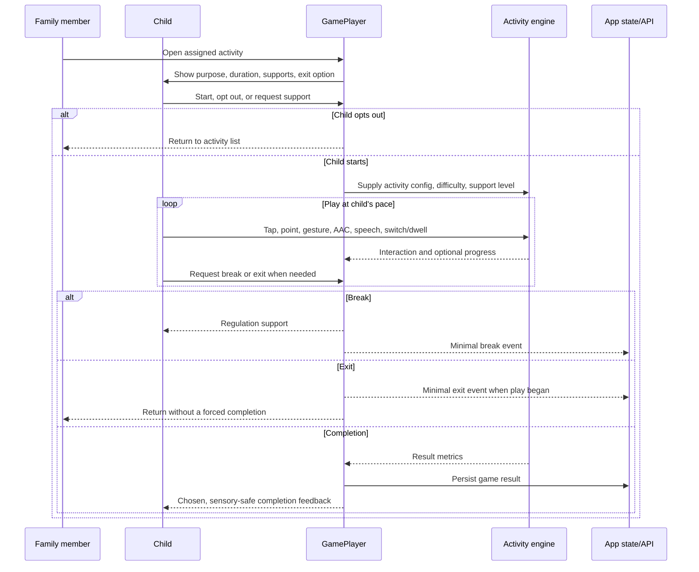
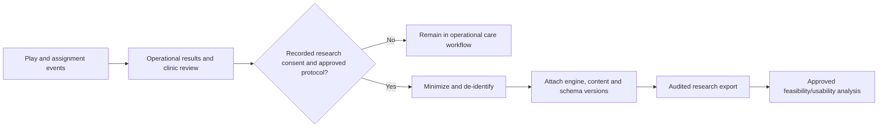

# Playground Life App Flow

**Purpose:** A role-based interaction map for the current application, including safe child-session exits and the production data boundary.

## 1. Primary workflow

## 2. Activity session detail

## 3. Planning and review flow

| Step | Therapist action | System responsibility | Family/child-facing result |
|---|---|---|---|
| 1 | Select child | Load clinic-scoped profile, goals, preferences, prior results | None |
| 2 | Choose focus | Suggest categories/difficulty with explanation | Plan reflects support needs and interests |
| 3 | Compose assignment | Validate activity IDs, due date, mode, and support | Clear list of manageable activities |
| 4 | Approve/adjust | Record approval and override rationale | Family sees approved plan, not an opaque model decision |
| 5 | Review | Compare results and observed engagement | Next plan may hold, advance, step back, or request review |

## 4. Operational versus research data flow

Only the right-hand research path may produce pilot/research exports. It must never be a hidden consequence of ordinary child play.

## 5. Flow rules and exceptions

- **No active assignment:** family view explains that there is nothing scheduled and provides a calm return path; it does not fabricate a task.
- **Game not found/config invalid:** show a recoverable error, do not mark completion, and surface a therapist/admin-visible issue.
- **Network/API failure:** avoid claiming a saved result until the write succeeds; offer a safe retry or explicit local-demo state.
- **Access changes during a session:** stop data mutation, protect the child from abrupt error language, and return the adult to sign-in.
- **Overwhelm or disengagement:** exit/break must be immediately available, with no loss of rewards or negative progress indicator.

## 6. Navigation inventory

| Route | Current owner | Main destination |
|---|---|---|
| `/` | Role selector | Therapist or family route |
| `/therapist` | Therapist | Sign in, child list, planning, review |
| `/family` | Family | Sign in, child activity list, activity session |
| `/admin` | Clinic admin | Sign in, staff/family management, audit review |

The role selector currently highlights therapist and family; preserve a clear, authorized path to clinic administration when refining entry navigation.
