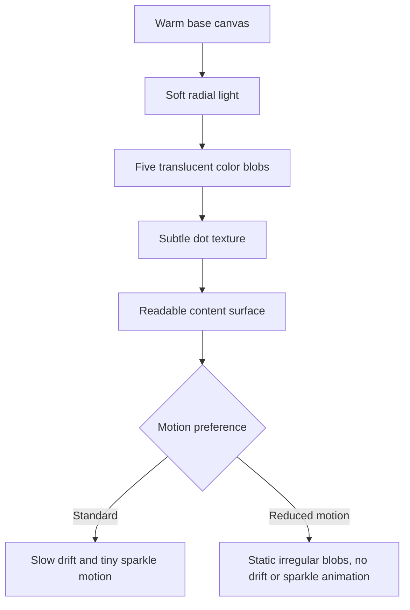

# Playground Life Design Brief

**Design intent:** Playful calm, not childish pressure. The interface should feel like a welcoming shared space for a child, caregiver, and therapist—not a reward machine or a clinical form disguised as a game.

## 1. Brand and experience direction

The current application already establishes a warm off-white canvas, Nunito display type, blue/green primary role cards, colored translucent blobs, sparkles, soft shadows, rounded surfaces, and optional motion. Preserve this friendly foundation while making the purpose of each screen clearer and the sensory intensity controllable.

The visual tone is **gentle playground studio**: tactile, optimistic, legible, structured, and respectful of a child's agency. Avoid loud gamification, crowded illustrations, clinical austerity, or infantilizing language.

## 2. Design system concept

| Layer | Direction | Existing cue |
|---|---|---|
| Canvas | Warm, low-contrast off-white with generous breathing room | `--background: 40 33% 96%` |
| Primary action | Calm sky blue; use for the single next action | `--primary: 199 60% 52%` |
| Family/support | Soft leaf green, not a competing primary on task screens | Existing secondary role card |
| Accent | Peach, lavender, sunshine, and green only as small semantic/playful cues | Animated blob palette |
| Typography | Rounded Nunito display for headings; clear sans body text | `--font-display: Nunito` |
| Shape | Rounded but not bubble-heavy: 12–20px for surfaces, full pills only for short metadata | Existing `rounded-xl/2xl` language |
| Motion | Slow, optional, and never instructional-only | `BlobBackground`, Framer Motion, reduced-motion branch |

## 3. Background visual style schema

This is a **visual/style schema**, not a database schema. The project already has a separate PostgreSQL schema and data dictionary for data modeling.

### Background tokens

| Token | Standard expression | Reduced-motion expression | Usage rule |
|---|---|---|---|
| Base | `hsl(40 33% 96%)` | Same | Always behind all content |
| Top light | Soft white radial wash | Same | Gives depth without contrast loss |
| Sky blob | `hsla(199, 78%, 58%, .44)` | Static | Entry screens and light play context |
| Peach blob | `hsla(25, 92%, 66%, .40)` | Static | Warmth, never error state |
| Leaf blob | `hsla(142, 54%, 56%, .40)` | Static | Family/support context |
| Lavender blob | `hsla(260, 52%, 74%, .32)` | Static | Variety; avoid dense text overlap |
| Sunshine blob | `hsla(45, 98%, 68%, .28)` | Static | Sparse celebratory accent |
| Texture | 26px faint white dot grid | Static or omitted | Decorative only; must not reduce readability |

## 4. Screen guidance

### Role selection

- Keep the large product name, short plain-language purpose, and two high-contrast role cards.
- Put one sentence beneath each card that describes the job, not a feature inventory.
- Provide a low-visual-noise authorized entry path for admin rather than hiding it behind accidental navigation.

### Therapist dashboard

- Organize around a daily clinical rhythm: **children → plan → review**.
- Use a child strip/list with clear active goal, current plan status, and attention-needed states; do not expose a dense dashboard grid by default.
- Explain recommendations inline: “Suggested because…” followed by recent, bounded evidence. Make “Adjust” equal in visual availability to “Approve.”

### Family dashboard

- Lead with one calm card: “Today’s plan” and a short estimate. De-emphasize scores and avoid urgency language.
- Make adult co-play guidance scannable: what to say, when to wait, and how to stop.
- Show completed and intentionally skipped activities as neutral history, not a streak or compliance score.

### Activity introduction and gameplay

- Present purpose, expected length, supports, and exit in a predictable fixed layout.
- Keep the primary play area uncluttered; show no more than one primary instruction and one optional support prompt at a time.
- Reserve celebration for child-selected or low-intensity feedback. Offer “Continue,” “Play later,” and “Done,” not pressure to repeat.
- Keep persistent, reachable controls for sound, voice, calm mode, AAC/core words, break, and exit.

### Admin dashboard

- Use a quiet operational interface with clear tables/lists for staff, family access, and audit review.
- Distinguish “ready now” from “needed before production” without implying external approval is complete.

## 5. Accessibility specifications

- Body copy must remain readable at 200% zoom without horizontal loss of essential content.
- Minimum target size: 44×44 CSS pixels for primary touch controls; increase activity choices where motor support requires it.
- Never communicate correctness, status, or next action by color alone.
- Use short, literal labels: “Take a break,” “Stop for now,” “Hear instructions,” “Turn sound off.”
- Preserve visible keyboard focus and logical reading order; test switch/dwell reachability.
- Motion, sound, and celebratory overlays must be individually controllable and honor saved preferences.

## 6. Do and avoid

| Do | Avoid |
|---|---|
| Make choices obvious and reversible | Auto-starting sound, video, or confetti |
| Use real child interests carefully | Treating profile details as decoration or surveillance fuel |
| Make support visible without stigma | Red warnings, “failure” badges, countdown pressure |
| Use a small, consistent icon vocabulary | Emoji-heavy dense controls or decorative clutter |
| Let adults see context, let children see simplicity | Showing clinical scores in the play surface |

## 7. Design acceptance criteria

- A child and caregiver can identify Start, Break, Help/AAC, Sound, and Stop within one screen without reading a long paragraph.
- Reduced-motion mode visibly removes ambient animation while retaining the same content hierarchy.
- Therapist recommendations are explainable and adjustable from the planning surface.
- Colors and overlays pass contrast/readability checks against the warm background.
- No visual treatment makes opt-out, AAC, sensory support, or slower interaction appear less successful than completion.
