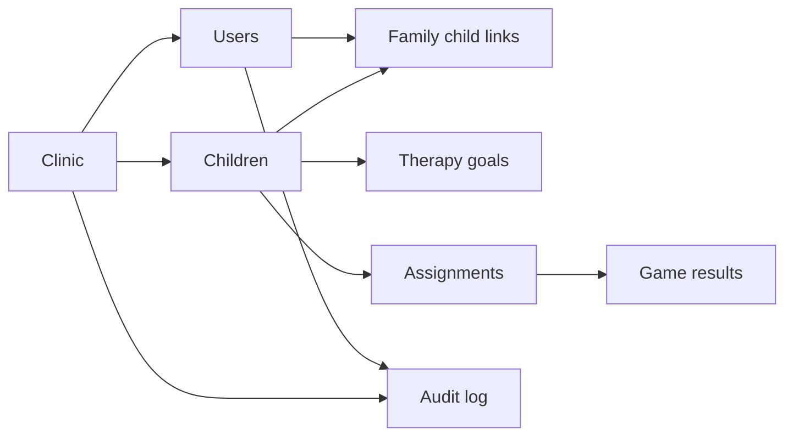

# Playground Life Database Schema Document

**Interpretation:** The original request said “Background Schema.” This document interprets it as the production database/backend schema, not the visual background system. It is grounded in `server/sql/001_init.sql` through `005_research.sql`, the Express routes, and the frontend API mapping.

**Database baseline:** PostgreSQL with UUID primary keys, `timestamptz` auditability, clinic-scoped records, and JSONB for bounded flexible profiles and engine metrics.

## 1. Schema purpose and boundary

The database is the production source of truth for clinic operations: authorized users, child profiles, family relationships, goals, assignments, play results, access evidence, and consent-gated research export records. Browser localStorage remains a demonstration path only and must never be treated as a production data store.

Every data access should start from the authenticated user's clinic scope. A foreign key is necessary but not sufficient: route queries must also prove role and relationship before reading or changing a record.

## 2. Core relationship map

| Domain | Tables | Ownership and purpose |
|---|---|---|
| Tenant and identity | `clinics`, `users` | A clinic owns users; a user has a role of admin, therapist, or parent. |
| Child care record | `children`, `family_child_links`, `therapy_goals` | A clinic owns children; links permit a family user to access a child; goals hold care-planning intent. |
| Plan and outcome | `assignments`, `game_results` | An assignment belongs to a child and clinic; results belong to an assignment and child. |
| Operations | `audit_log`, `password_reset_tokens`, `staff_invitations`, `email_outbox`, `backup_runs`, `retention_runs` | Evidence, lifecycle operations, and administrative delivery support. |
| Child support signals | `child_moods`, `child_events`, `child_preferences`, `child_rewards` | Minimal mood/regulation, sensory preference, and child-facing reward state. |
| Research governance | `schema_migrations`, `research_exports`, consent fields on `children` | Consent state and export accountability, separate from ordinary care delivery. |

## 3. Core tables and key fields

| Table | Primary fields | Important constraints / relationships |
|---|---|---|
| `clinics` | `id`, `name`, timestamps | Tenant root. |
| `users` | `clinic_id`, `role`, name, email/phone, password hash, credential status | Email or phone required; unique email and clinic-normalized phone indexes; Argon2id hash is supplied by the application. |
| `children` | `clinic_id`, names, birth date, diagnosis, notes, JSONB profiles | Clinic-scoped; retains personalization, skill, progression and research-consent fields. Sensitive fields require purpose limitation. |
| `family_child_links` | `clinic_id`, `child_id`, `user_id`, relationship | Unique child-user pair; enables caregiver-to-child authorization checks. |
| `therapy_goals` | `child_id`, domain, title, target level, status | Target level constrained to 0-100; status is active, paused, or achieved. |
| `assignments` | child, clinic, family user, activity IDs, difficulty, mode, approval | Enums/checks bound type, state, difficulty, mode, support level, and approval; `game_ids` is an array of stable catalog IDs. |
| `game_results` | assignment, child, game ID, completion time, duration, score, interactions, JSONB metrics | One result per assignment/activity ID; score is 0-100 and duration/interactions are non-negative. |
| `audit_log` | clinic, actor, action, entity, details, IP, user agent, timestamp | Append-oriented accountability record; retain only minimally necessary detail. |

## 4. Sensitive data and JSONB contract

The schema uses JSONB where activity engines and personalization can vary. This flexibility must remain governed by versioned, typed application contracts.

| JSONB field | Intended contents | Guardrail |
|---|---|---|
| `children.personalization_profile` | Interests, support needs, communication/sensory preferences | Validate keys in the API; do not add free text without a defined care purpose. |
| `children.skill_profile` | Domain-level support signals | Do not treat scores as diagnostic or normative rankings. |
| `children.progression_settings` | Therapist-managed progression/adaptation preferences | Preserve explainable, reversible overrides. |
| `assignments.monthly_plan` / `tuning` | Approved plan and activity-level adjustments | Persist author/approval evidence when the plan changes. |
| `game_results.metrics` / `skill_scores` | Bounded engine metrics and learning signals | Version content and engine payloads; avoid raw coordinates and unnecessary traces. |
| `audit_log.details` | Structured operational context | Exclude secrets, raw credentials, and excess PHI. |

## 5. Governance, consent, and exports

`005_research.sql` adds `research_consent`, consent version, timestamp, and responsible user to `children`; `research_exports` records an export request, filter version, record count, lifecycle status, and error. This creates a governance baseline, but it is not permission to collect research data by default.

- Operational care data and research data must remain separate in purpose and access control.
- Research export must require recorded consent, approved protocol, clinic scope, de-identification, and audit/export logging.
- Free text must be excluded by default. Child identifiers, assignment identifiers, and coordinates must not leave the operational boundary in raw form.
- A per-clinic secret in protected configuration must pseudonymize research identifiers. The current route's deterministic string salt is a development placeholder, not production key management.

## 6. Migration and implementation status

| Area | Current repository state | Required production action |
|---|---|---|
| Migration runner | `server/migrate.ts` executes only `001_init.sql` | Apply `001` through `005` in lexical order, record versions in `schema_migrations`, and test clean and upgrade paths. |
| Express mounting | Auth, children, assignments, and audit routes are mounted | Mount family, goals, child-data, rewards, compliance, and research only with authorization and route tests. |
| Research query | Consent filter is present in `routes/research.ts` | Replace interpolated `IN (...)` child IDs with a parameterized array query before mounting. |
| Tenant isolation | Core tables carry `clinic_id`; APIs use role middleware | Assert clinic ownership/relationship on every SELECT, INSERT, UPDATE, and DELETE. |
| Retention | `retention_runs` and policy drafts exist | Implement approved schedules, deletion evidence, backup restore drills, and access reviews. |

## 7. Database acceptance criteria

- A new database applies every numbered migration exactly once and records each version; an existing `001` database upgrades without data loss.
- API integration tests prove that a parent cannot read an unlinked child, staff cannot cross clinic boundaries, and an actor cannot create a result for an unrelated assignment.
- JSONB payloads are schema-validated, content/engine-versioned where needed, size-bounded, and free of secrets or unapproved raw interaction data.
- Backup/restore, retention, audit review, and research-export evidence are tested in a non-production environment before real clinic records are stored.
- The production data path is clearly separated from the demo localStorage path in configuration, UI, and automated tests.
