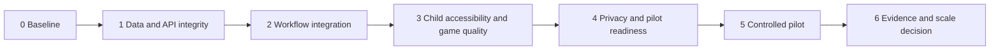

# Playground Life Implementation Plan

**Purpose:** A sequenced plan for moving the current application from a feature-rich prototype and backend foundation to a safer, pilot-ready clinic product. This plan does not authorize clinical efficacy claims or live PHI/PII deployment without the approvals already identified in project governance documents.

## 1. Guiding approach

Deliver in small vertical slices that preserve child autonomy, clinic safety, and current workflow behavior. Each slice must leave the product more testable and more deployable than before. Avoid a broad rewrite: use the existing React/Vite frontend, Express API, PostgreSQL model, catalog, engine contracts, and governance documents as the foundation.

## 2. Phase 0 - Establish the release baseline

**Outcome:** The team knows what is running, what is demo-only, and what a change must not break.

- Record the current commit, environment assumptions, known working-tree changes, supported browsers, and test command results.
- Map every frontend action to either local demo state or an API call; label this boundary in the UI and developer documentation.
- Inventory all API route files and compare them with routes mounted in `server/index.ts`.
- Create a release checklist covering tests, build, lint, typecheck, migration upgrade, accessibility checks, and backup/restore verification.

**Exit criteria:** A developer can set up the app from `.env.example`, start client/API, distinguish demo from production paths, and reproduce a recorded validation run.

## 3. Phase 1 - Make data and API integrity production-grade

**Outcome:** PostgreSQL migrations, authorization, and data writes are dependable and clinic-scoped.

1. Replace the single-file migration execution with an ordered migration runner that applies `001` through `005`, writes `schema_migrations`, and supports both fresh and upgrade databases.
2. Add integration tests for each migration path, foreign key, constraint, and rollback/restore process.
3. Audit every route: validate request bodies with a shared schema, parameterize SQL, bind clinic scope to the authenticated user, and return safe error messages.
4. Mount only fully reviewed route modules. Add health, readiness, and structured error/observability behavior suitable for deployment.
5. Fix research-export SQL interpolation and move pseudonymization secrets out of source-derived deterministic strings.

**Exit criteria:** Clean install and upgrade pass; no query uses string interpolation for data values; cross-clinic and role-restriction tests pass; backup/restore drill is documented and successful.

## 4. Phase 2 - Integrate the end-to-end care workflow

**Outcome:** One real, authorized workflow works from planning through review.

1. Therapist creates/selects child, adds a goal, chooses activities and supports, and saves an assignment through the API.
2. Linked family signs in and sees only their authorized child's assigned session.
3. Activity completion writes a validated game result and advances assignment status without duplicate results.
4. Therapist sees completion, intent, score/metrics, and any intentional exit/break context in a review surface.
5. Admin can manage staff/family credentials and see audit evidence for these actions.

**Exit criteria:** An automated E2E test and a human walkthrough complete the same workflow against PostgreSQL, with no dependence on demo local state.

## 5. Phase 3 - Standardize adaptation and child-accessible gameplay

**Outcome:** The activity system is coherent, explainable, and usable at each child's pace.

1. Define one typed adaptation decision contract for assignment difficulty, support level, readiness, and engine tuning.
2. Show the recommendation reason and source; let authorized therapists override, hold, or reverse it.
3. Establish an engine contract that requires start, pause/break, exit, completion, valid input modes, sensory preference handling, and bounded metrics.
4. Audit the 192 catalog entries for unique mechanics versus content/theme variants; maintain an honest mechanics inventory.
5. Prioritize additions that expand meaningful play: communication choice, regulation, daily living, flexible thinking, and collaborative play without forcing a normative social response.

**Exit criteria:** Every supported engine conforms to the contract and is covered by smoke/interaction tests; adaptation decisions are visible, reversible, and auditable; no activity requires eye contact, speech, speed, or uninterrupted completion.

## 6. Phase 4 - Accessibility, design, and sensory quality pass

**Outcome:** The product remains calm and navigable across child, family, and clinician contexts.

- Implement the design brief and background schema as shared tokens rather than per-screen styling.
- Test keyboard, visible focus, switch/dwell, touch-target sizing, text scaling, AAC access, audio controls, and reduced motion on every activity and critical workflow.
- Ensure “take a break,” “stop for now,” and opt-out are immediate, neutral, and always available during play.
- Reduce visual intensity on task screens; never place animated backgrounds behind instructional targets.
- Conduct co-design sessions with autistic children, caregivers, and therapists; record changes as product decisions, not universal assumptions.

**Exit criteria:** Accessibility acceptance tests pass, feedback from co-design participants is triaged, and low-sensory/reduced-motion flows have no auto-playing motion or sound.

## 7. Phase 5 - Privacy, security, and pilot readiness

**Outcome:** The clinic can decide responsibly whether to start a limited feasibility/usability pilot.

| Workstream | Required deliverable |
|---|---|
| Consent | Versioned guardian consent and withdrawal workflow; clear operational vs research distinction |
| Data governance | Approved retention, deletion, export, access-review, and incident-response procedures |
| Security | Independent security/data-protection review and tested remediation record |
| Research data | De-identified, consent-filtered, provenance-rich export with documented data dictionary |
| Operations | Deployment runbook, monitoring, backup/restore evidence, support/issue process |
| Pilot protocol | Approved outcomes, success thresholds, recruitment, and adverse-event/escalation path |

**Exit criteria:** Required approvals are documented; security/privacy blockers are resolved or explicitly accepted by accountable owners; a pilot cannot start until these conditions are met.

## 8. Phase 6 - Controlled pilot and evidence decision

**Outcome:** The team obtains trustworthy feasibility and usability evidence, then decides whether and how to expand.

- Run the approved 6-8 week clinic/family pilot using consented participants only.
- Measure therapist task completion, family completion/intentional-skip rates, setup/review time, recommendation usefulness, caregiver usability, and safety/privacy/accessibility issues.
- Hold weekly triage focused on child experience and safe fixes; do not silently alter data definitions mid-pilot.
- Publish a feasibility/usability report only after data quality and protocol completion are confirmed. Frame findings without clinical efficacy claims.
- Make a scale, iterate, or stop decision based on predefined criteria, participant feedback, and unresolved risk.

## 9. Delivery cadence and ownership

| Cadence | Product | Engineering | Clinical/research | Operations |
|---|---|---|---|---|
| Weekly | Prioritize validated user problems | Ship small vertical slices and record test evidence | Review safety, autonomy, and interpretation risks | Review incidents, access, backups |
| Per release | Confirm scope and acceptance criteria | Build, test, migrate, deploy with rollback | Approve content/adaptation changes where needed | Verify monitoring and release checklist |
| Per pilot milestone | Review feasibility signals | Freeze/version data contracts | Review protocol adherence and consent | Confirm retention and export controls |

## 10. First 30 days

1. Complete Phase 0 and the migration/API integrity work in Phase 1.
2. Select one clinic workflow for Phase 2 and automate it end to end.
3. Write and enforce the engine/adaptation contract, then remediate the highest-used engines first.
4. Run focused accessibility and co-design review sessions before design expansion.
5. Assign accountable owners and target dates for pilot-readiness workstreams; do not set a pilot date before readiness gates are met.

## 11. Definition of done for the plan

The implementation plan is complete only when the product has a verified production data path, accessible and autonomy-preserving child sessions, clinic-scoped workflows, documented privacy/security readiness, and an approved, evidence-generating pilot path. Completion of a UI, route, or game alone is not sufficient.
